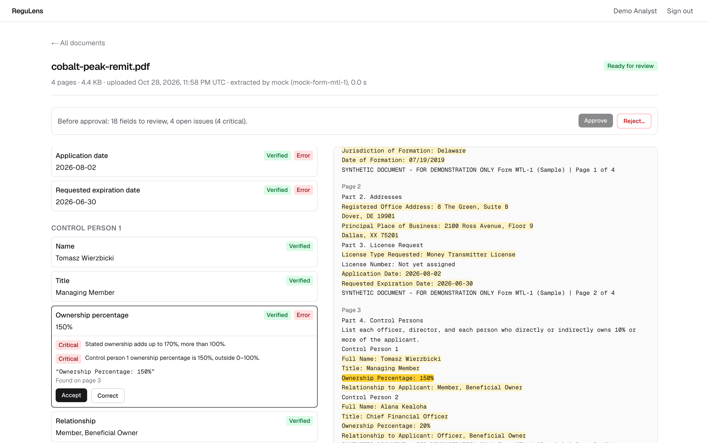
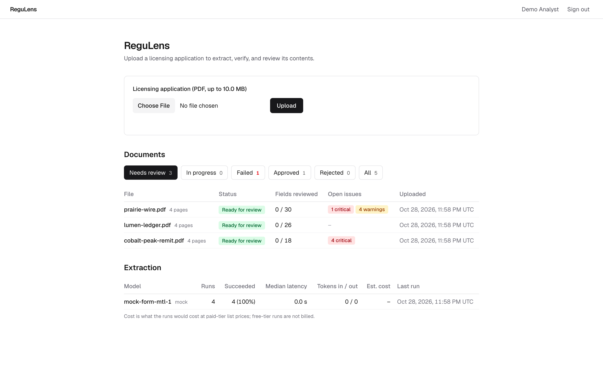
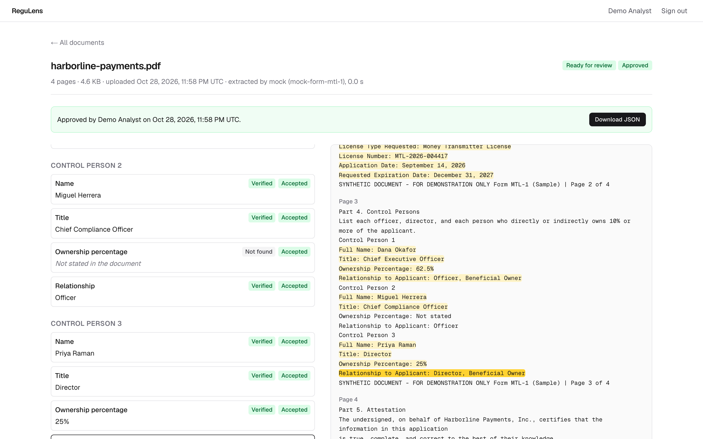

# ReguLens

AI-assisted intake for business licensing applications: a PDF goes in, and a structured,
validated record comes out, with every value traced to the words it came from and
approved by a person.

> Independent portfolio project. All sample documents and data are fictional.

**Live demo:** LIVE_DEMO_URL. The sign-in page shows a shared demo account. The demo
uses mock extraction (no AI key on the server, nothing sent to a model), so upload the
[sample applications](samples/), not other PDFs.



## What it does

A compliance analyst uploads a licensing application (a fictional, NMLS-style Money
Transmitter License application: company details plus each control person). Then:

1. **An LLM drafts the extraction.** Google Gemini fills a fixed schema: each field is
   `found` (with a value and the quote it came from), `not_found`, or `ambiguous` (with
   candidates). Nothing is guessed into an empty string.
2. **Code checks the model's work.** Every quote is searched for in the PDF's text; a
   quote that isn't there flags the field. Business rules (dates in order, ownership
   within 0–100% and adding up, valid state codes, required fields) raise issues graded
   critical, warning, or info.
3. **The analyst decides.** The review screen shows each field beside the document text
   with its evidence highlighted. The analyst accepts or corrects each value and resolves
   each issue; corrections are re-validated. Approval needs every field reviewed and no
   open blocking issue, and every action goes to an append-only audit log.
4. **Approved records export as JSON**, with each value labeled as extracted (with its
   evidence), corrected (with the model's original), or missing.

| Dashboard | Approved document |
|---|---|
|  |  |

## Why it's built this way

An LLM is good at reading messy documents and bad at being accountable. ReguLens treats
the model's answer as a draft that has to prove itself:

- **Evidence is verified, never trusted.** The model must cite page and quote; the code
  normalizes both sides and finds the quote, or the field is flagged. A verified quote must
  also contain the value, so a real quote attached to the wrong value is caught too.
- **Schema checks shape; rules check meaning.** An ownership of 150% passes the schema
  (that is what the document says) and fails validation, so the analyst sees it instead
  of it being silently dropped.
- **Raw, normalized, and current values are kept apart.** The model's value is never
  overwritten, so analyst corrections double as labeled evaluation data.
- **The database decides races.** Processing is a state machine of conditional `UPDATE`s
  with an attempt counter as a fencing token; review commands lock the document row.
- **Measured, not assumed.** `pnpm eval` scores extraction against the ground truth the
  samples were generated from, including how many wrong values the checks caught.

[docs/ARCHITECTURE.md](docs/ARCHITECTURE.md) covers the design and the reasoning behind each
decision.

## Stack

TypeScript (strict) end to end · Next.js 16 (App Router, Server Actions, `after()`) ·
React 19 · PostgreSQL with Drizzle ORM · Zod · Tailwind CSS · Google Gemini API
(`@google/genai`) behind a provider interface, with a mock for tests and the demo ·
unpdf (pdf.js) for text extraction · Vitest (unit and integration against a real
Postgres) · Playwright (end to end against a production build) · deployed on Vercel with
Supabase Postgres and Storage.

```
Browser ──► Next.js on Vercel ── server actions, pages, export route
              ├─ pipeline (after the upload responds):
              │    parse PDF ─► extract (Gemini / mock) ─► verify evidence ─► validate
              ├─► Postgres (Supabase): documents, fields, evidence, issues, audit log
              └─► Supabase Storage: original PDFs, private, content-addressed
```

## Running it locally

### Requirements

- Node.js 24 (`nvm use` reads `.nvmrc`)
- pnpm 10 (`corepack enable && corepack prepare pnpm@10 --activate`)
- Docker (for local Postgres)

### Setup

```bash
nvm use
pnpm install
cp .env.example .env.local
pnpm db:up        # start Postgres in Docker
pnpm db:migrate   # apply migrations
pnpm db:seed      # demo organization and analyst@example.com (password: regulens-demo)
pnpm check        # lint + typecheck + unit tests
pnpm test:integration   # upload flow against a separate regulens_test database
pnpm test:e2e     # browser tests against a production build (see below)
pnpm dev          # http://localhost:3000
```

## Sample documents

`samples/` holds fictional applications rendered by `pnpm samples` (deterministic output):

| File | Purpose |
|---|---|
| `harborline-payments.pdf` | Complete and consistent; should validate cleanly |
| `cobalt-peak-remit.pdf` | Deliberate problems: ownership over 100%, invalid state, dates out of order |
| `lumen-ledger.pdf` | Clean, with harder values: three DBA names, spelled-out state, abbreviated months, ZIP+4, accented name |
| `prairie-wire.pdf` | Mostly warnings: registered office out of state, impossible date, short ZIP, owner without a percentage |
| `scanned-no-text-layer.pdf` | No text layer, like a scan; stored but marked failed (no OCR) |

The fixtures in `scripts/samples/fixtures.ts` are also the ground truth for evaluation.

## AI provider

ReguLens uses the Google Gemini API free tier. Without a key it falls back to mock
extraction, so everything except real extraction works offline.

1. Sign in at [Google AI Studio](https://aistudio.google.com/apikey) and create an API key.
   No billing account is needed for the free tier.
2. Put it in `.env.local` (never in `.env.example`, never in client code):
   ```
   GEMINI_API_KEY=your-key
   ```
3. Optional: `GEMINI_MODEL` (default `gemini-3.8-flash`), or `AI_PROVIDER=mock` to force mocks.
4. Try it on a sample (prints the result and run metrics; stores nothing):
   ```bash
   pnpm extract samples/harborline-payments.pdf          # Gemini if a key is set
   pnpm extract samples/harborline-payments.pdf --mock   # always offline
   ```

The mock provider reads the "Label: value" lines of the sample form layout and answers in
the same JSON a model would, so its output goes through the same validation. On any other
layout it reports every field as not found.

Free-tier limits vary by model and are shown in
[AI Studio](https://aistudio.google.com/rate-limit). Free-tier inputs may be used by Google
to improve its products, so use only synthetic documents.

## Evaluation

`pnpm eval` extracts every sample and scores it against the fixtures it was rendered from
(`scripts/samples/ground-truth.ts`). Nothing is stored; it makes one model call per sample.

```bash
pnpm eval                          # Gemini if a key is set
pnpm eval --mock                   # offline; the mock should score 100%
pnpm eval --json eval-report.json  # also write the full report
```

It reports:

- **Field accuracy.** Values are compared after the app's own normalization (ISO dates,
  state codes) and whitespace folding; case and punctuation still count. Each field is
  `correct`, `correct_absent`, `wrong_value`, `missed`, `invented`, or `ambiguous`.
- **Evidence located.** Of the values the model returned, how many cite text that exists.
- **Errors flagged.** Of the fields the model got wrong, how many a validation issue
  names. An unflagged error (a real quote, but for the wrong value) is the kind only
  an attentive analyst catches.
- **Issue agreement.** Validation is run on the true values and on the extraction; issues
  raised only on the truth are problems the analyst would not be shown.
- Latency, tokens, and the paid-tier cost estimate.

## End-to-end tests

`pnpm test:e2e` builds the app, starts it on port 3100 against its own `regulens_e2e_test`
database with mock extraction, and drives it in headless Chromium with Playwright. No API
key or network is needed; Postgres must be running (`pnpm db:up`).

```bash
pnpm exec playwright install chromium   # once
pnpm test:e2e
pnpm test:e2e --ui                      # watch the tests run, step by step
```

The specs cover signing in and out, uploading (including a duplicate and a scanned PDF),
reviewing every field through to approval and the JSON download, and correcting a value,
seeing the issues it fixes close, and rejecting. The database is reset at the start of the
run and its document tables before each test, so the specs run one at a time.

## Screenshots

The images in `docs/screenshots` are produced by a Playwright script against the same
production build and mock extraction as the end-to-end tests, so they can be regenerated
after a UI change:

```bash
pnpm screenshots
```

## Deployment

The live demo runs on Vercel (Hobby) with Supabase Postgres and Storage, all on free
tiers. Locally, files go to disk; with `STORAGE_BACKEND=supabase` they go to a private
Supabase Storage bucket through its REST API. Vercel connects through Supabase's
transaction pooler, so prepared statements are off. Every table has row-level security
enabled with no policies, so Supabase's auto-generated Data API exposes nothing even if
it is switched on; the app connects as the table owner and is unaffected.

The public demo sets `PUBLIC_DEMO=true` (the sign-in page shows the shared account),
`AI_PROVIDER=mock`, and `MAX_DOCUMENTS` to cap what visitors can upload.

[docs/DEPLOYMENT.md](docs/DEPLOYMENT.md) is the step-by-step runbook, including security
checks, resetting demo data, and troubleshooting.

## Limitations

- **One document type.** The schema, prompt, and rules are for one fictional application
  form. Another type means another schema and rule set on the same pipeline.
- **No OCR.** A scanned PDF is stored and marked failed with a reason.
- **Text view, not a PDF viewer.** Evidence is highlighted in the extracted page text, not
  drawn on the rendered page.
- **Live extraction quality is not yet measured.** The Gemini provider is unit-tested
  against stubbed API responses, and the eval harness is ready, but no scores against the
  live model are published here yet. The public demo uses the mock provider.
- **Processing runs in the web process** (`after()`), not on a job queue. A run that dies
  is detected as stale after 15 minutes and can be retried, but nothing retries it
  automatically.
- **Single organization.** Every table and query is scoped by `organization_id`, but there
  is no way to create a second organization, and no roles beyond analyst.
- **Free-tier data use.** Google may use Gemini free-tier inputs to improve its products,
  so only synthetic documents belong there.
